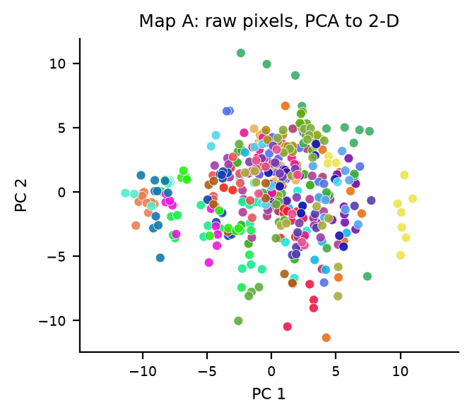
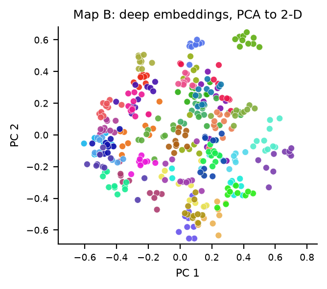
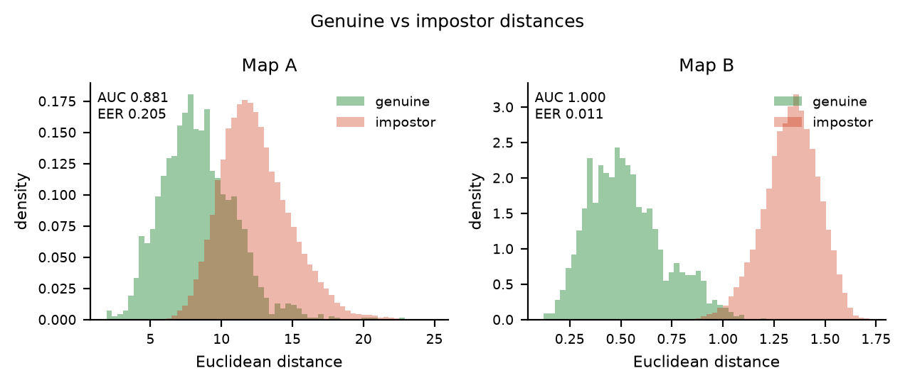
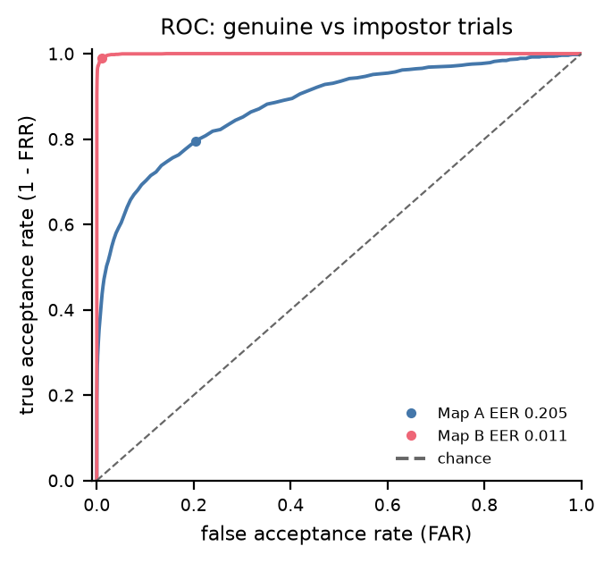
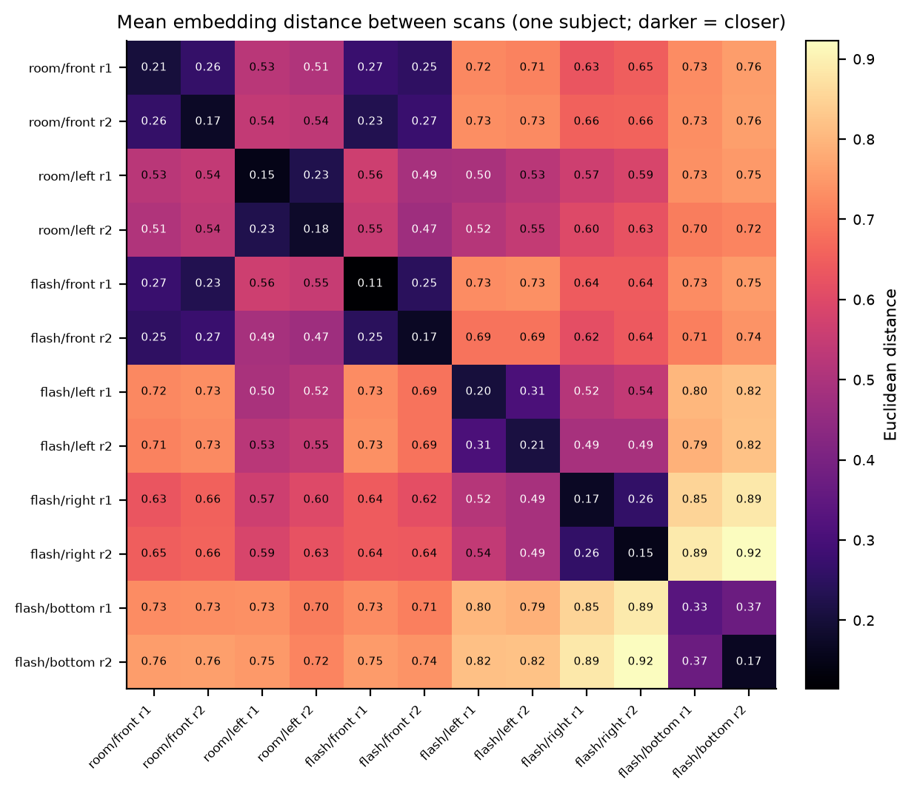
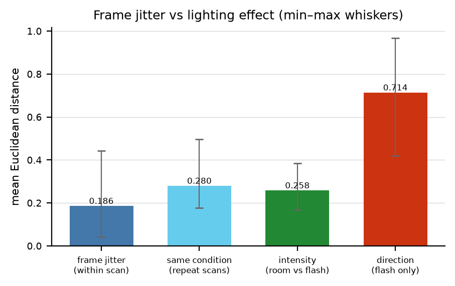

# Face Embedding Map

> **Do learned face embeddings separate *identity* better than raw pixels do — and can I show it
> with a number, not just a nice-looking picture?**

This repo answers that question two ways on the same 400 faces, then takes the winning representation
out of the lab and points a webcam at it.

- **Map A — raw pixels / Eigenfaces.** Flatten each 64×64 Olivetti photo to 4096 numbers, run PCA,
  plot. The 1991 method, implemented properly rather than as a strawman.
- **Map B — learned embeddings.** Push the same photos through a *frozen*
  InceptionResnetV1 pretrained on VGGFace2, get a 512-number unit vector per face, run **the same
  PCA with the same settings**, plot the same way.
- **The live study.** 12 webcam scans of my own face × 10 frames, under six lighting conditions
  (room light and phone flash, from front / left / right / below), to see where the embedding moves
  when the only thing changing is the light.

No model is trained anywhere. The network is frozen in `eval()` mode; the comparison is about what
each representation *already* contains.

**The paper:** [`paper/main.pdf`](paper/main.pdf) — method, architecture diagrams, full results,
limitations, and a reproducible protocol. This README is the short version.

---

## The headline

All metrics are computed in **full dimensionality** (4096-d and 512-d), never on the 2-D plots.
400 images, 40 identities, 10 photos each. The verification numbers below are descriptive,
**in-sample operating points** on this known 40-identity population; they are not independently
calibrated rates for unseen webcam users.

| metric | Map A (raw pixels) | Map B (embeddings) |
|---|---|---|
| silhouette (higher is better) | 0.106 | **0.497** |
| 1-NN leave-one-out accuracy | 94.5 % | **100 %** |
| 1-NN top-5 | 98.3 % | **100 %** |
| ROC-AUC, genuine-vs-impostor pairs | 0.881 | **0.9995** |
| EER, pair protocol (lower is better) | 20.5 % | **1.11 %** |
| EER, verification protocol | 8.7 % ± 1.2 | **0.22 % ± 0.24** |
| TAR @ FAR = 10⁻³, pair protocol | 26.4 % | **95.5 %** |
| TAR @ FAR = 10⁻², pair protocol | 42.3 % | **98.8 %** |
| TAR @ FAR = 10⁻³, verification protocol | 59.0 % | **99.4 %** |
| FAR @ FRR = 1 %, verification protocol | 48.6 % | **0.044 %** |
| d′ | 1.61 | **4.99** |

The two protocols must not be conflated. The **pair** protocol scores one probe against one gallery
image. The **verification** protocol scores a probe against the *minimum* distance to five enrolment
images — one possible multi-template verifier rule — so both maps improve, and the ranking
does not change.

**The descriptive comparison:** on the same Olivetti trials used to choose the operating points,
at an empirical 0.1 % false-accept target Map B accepts 99.4 % of genuine probes versus 59.0 % for
raw pixels; at a 1 % target it is 99.9 % versus 74.4 %. At an in-sample 1 % false-*reject* point,
raw pixels accept 48.6 % of known-population impostor trials versus 0.044 % for Map B. The
**interpolated** verification EER is 38.8× lower, but its 0.22 % Map B value is below the 0.5 %
genuine-trial grid and is **not** a directly realisable threshold.

**Identity-disjoint check:** across five overlapping partitions, 13 identities select a threshold,
13 different identities form the evaluation gallery, and 14 further identities are unknown to that
gallery. At a nominal 1 % *calibration* FAR, held-out TAR is **75.1 % / 100 %** (A/B) and per-claim
FAR is **1.21 % / 0.77 %**. Yet **18.9 % / 12.1 %** of unknown Olivetti probes are accepted as
*somebody* among the 13 enrolled identities. This any-of-13 rate is different from the per-claim
FAR; the five partitions reuse people and do not provide independent confidence intervals. See
`results/threshold.json`. **No Olivetti number calibrates a webcam.**

Raw pixels are not useless—94.5 % of nearest neighbours have the right identity—but the
verification distributions overlap much more than the pretrained embeddings on this dataset. The
gap combines training data, model architecture and representation; this experiment does not
isolate illumination as its sole cause.

---

## The two maps

Same 400 points, same PCA settings (`n_components=2`, randomized SVD, seed 0), same colours for the
same identities, same axis conventions. Only the representation changes.

**Map A — raw pixels:**


**Map B — learned embeddings:**


And here is the trap this project is about: **Map B looks *less* clustered than Map A.** That is not
a failure of the embedding; it is a failure of the 2-D projection. I measured how much of the true
geometry each plot preserves (Spearman correlation between 2-D and full-dimensional pairwise
distances): **0.807 for raw pixels, 0.517 for embeddings.** Map A's two lobes are not people: its
first axis correlates **0.986** with the mean brightness of the photo and its second **0.945** with
the left–right brightness gradient. The embedding's identity structure is spread across hundreds of
dimensions, so squashing it to 2-D destroys it. The nicer-looking map is the worse space.

This is the project's central methodological rule: **measure in full dimensions, plot in 2-D, never
measure on the plot.**

The metrics behind the table:




Why the embedding wins is visible in the histograms: for Map B the genuine and impostor distributions
almost separate (EER 1.11 %); for Map A they overlap heavily (EER 20.5 %).

---

## The lighting experiment (one subject, twelve scans)

12 scans × 10 frames = 120 embeddings of me, captured 6 September 2026. Two scans per condition, so
"same condition, different minute" is the noise floor.





What it shows, on the 0–2 Euclidean scale for unit vectors:

- **Frame-to-frame jitter** within one scan: mean **0.186** (max 0.442). This describes
  single-frame variability, not a necessary threshold for a five-reference verifier.
- **Same condition, second scan**: mean **0.280**. Repeating the capture in the same light is worse
  than consecutive frames, as expected.
- **Light intensity** (room light vs phone flash, both front): mean **0.258**, inside the
  repeat-scan range. This is an observation for two scan groups; brightness, pose and camera
  auto-exposure were not experimentally isolated.
- **Light direction** (flash only, front/left/right/bottom): mean **0.714**, i.e. **3.83×** the
  frame jitter. Front-lit vs left-lit is 0.71; right-lit vs bottom-lit reaches **0.967**, the single
  worst same-person distance in the dataset.
- **Under-lighting is hardest in these captures.** Bottom-lit scans are the noisiest and among
  the furthest from the others. A training-data explanation is plausible, not tested here.
- **Frames are not independent.** Distance grows with frame lag: 0.153 between consecutive frames,
  0.257 between the first and last frame of a scan. Small head/pose drift happens during the ~2 s
  capture, so ten frames are not ten independent samples. Frame 0 is an outlier (0.243 mean distance
  vs 0.167 at frame 5) — which is why `scripts/live_capture.py` now throws away warm-up frames.
- **Pooling check:** averaging the ten frames of a scan before re-normalising reduces mean
  across-scan distances by **4.8 %** in these captures. That does not establish a change in
  verification FAR or FRR.

**Where does a threshold go?** The worst observed *single-frame pair* is **0.967**. With that
particular frame as the only enrolment reference, a lower Euclidean threshold would reject its
partner; a five-frame enrolment system may still accept via a closer reference. The study has no
same-domain stranger scores, so it cannot choose a secure live threshold.

**No stranger scan exists yet.** Every number in this section is me-vs-me. A cross-domain sanity
check (distance from my scans to the 400 Olivetti embeddings) gives a mean of per-Olivetti minimum
distances of **1.288** and an overall minimum of **0.887** — the ranges overlap and the comparison is
confounded (different capture, crop and resolution), so it is **neither an upper nor a lower bound**
on webcam stranger distances. The Olivetti analysis is a controlled known-population comparison,
not a calibrated webcam security result. This is the biggest limitation in the repo.

---

## What this means for FaceID

A FaceID-style system is a distance threshold: below `X` accept, above `X` reject. The project makes
you feel the trade-off instead of reading about it:

- Tighten `X` and your own dim/bottom-lit photo gets rejected (FRR rises).
- Loosen `X` and more nonmatching probes would be accepted (FAR rises); this project has no
  webcam stranger trials.
- Interpolated EER summaries on Olivetti are **8.7 %** for pixels and **0.22 %** for embeddings;
  at the latter reported threshold empirical FAR and FRR need not equal that interpolated number.
  The original trial-selected FAR/TAR points are in-sample, not independently calibrated.
- The threshold is **domain-specific**. A number fitted on Olivetti's tightly cropped, aligned,
  greyscale faces does not transfer to a webcam frame without recalibration — and that is exactly
  the kind of thing that is easy to get wrong when quoting a single benchmark number.

---

## What I got wrong (and what I fixed)

- **I had a claim, not a result.** Map A was finished enough to look at but the 2-D scatter, the
  silhouette score and the Map B comparison — the actual experiment — were still "to do" after the
  first write-up. This build finishes them.
- **I eyeballed the eigenfaces, twice.** I guessed 6 components mattered, then 20–30 after looking at
  the scree plot. The measurement said 19 components for 75 % of variance and 66 for 90 %. The flat
  tail is not empty: components 20–66 carry another 15 %.
- **I called the model "robust to lighting".** One front-lit room-versus-flash contrast lies within
  the repeat range, while changing flash direction accompanies a 3.8× larger mean than frame
  jitter. This small observational study does not isolate light from pose/exposure.
- **I under-reported my own worst case.** The findings quoted 0.94 as the worst same-person
  *frame-pair* distance; the data says 0.967. This is not a minimum viable multi-template threshold.
- **I talked about a "noise floor" without measuring within-scan variation.** The old number was
  between-scan variation. The two means (0.186 within, 0.280 between) describe variation, not
  necessary multi-template verifier thresholds.
- **I mixed up Euclidean and cosine naming.** The live distances are Euclidean between unit vectors
  (`d² = 2 − 2cos`). The plan said "cosine is standard" while the code used Euclidean. Same ranking,
  different scale — dangerous when comparing with other papers. Now both are reported.
- **PCA was quietly non-deterministic.** scikit-learn picks the randomized SVD solver for this data,
  and the notebook left `random_state=None`: identical cells gave explained-variance ratios differing
  by up to 1.8×10⁻⁵. Fixed with `seed=0`.
- **The pipeline existed twice.** `scripts/compare_scans.py` and the notebook each had their own data
  loading and distance code; a third copy was coming for Map B. Now one library (`fem/`) does each
  stage once.
- **I forgot the webcam warms up.** The first frames are black (mean brightness 3/255), so early
  frames silently produce no face. They are now discarded, and the data confirms frame 0 is the
  outlier.
- **I fit PCA on the probe images.** Transductive for the 2-D plots, but the headline metrics use
  the original full vectors, not PCA coordinates. The fit cannot justify calling the measured
  Map A/Map B gap conservative; the limitation is stated rather than hidden.
- **I committed almost nothing.** At the start of this pass, `git` tracked a PyCharm `main.py`
  boilerplate and one notebook; none of the scans, scripts, findings or plans were in the repo. Fixed.

---

## Reproduce it

Run from a source checkout with Python 3.12+, a local LaTeX installation for the paper, and the
VGGFace2 checkpoint. Exact experiment package versions are listed in `requirements.txt`; package
metadata declares runtime dependencies, but neither the checkpoint nor the dataset is bundled in
the wheel. The first model/Olivetti run can require a network download; compare the checkpoint hash
reported in `results/model_arch.json` before comparing numbers across machines.

```sh
python3 -m venv .venv
. .venv/bin/activate
python -m pip install -r requirements.txt
python -m pip install -e . --no-deps    # source checkout; FEM_PROJECT_ROOT can override data root
make test                              # pytest suite, offline with cached data
make all                               # tests + all experiment runners
make diagrams                          # rebuild TikZ architecture diagrams
make paper                             # compile paper/main.pdf (two passes)
make notebook                          # executes notebook in place; tracked outputs may change
```

If using an already-provisioned environment instead, run `make PY=/path/to/python all`. The
runners are `analysis/run_olivetti.py`, `analysis/run_live.py`, `analysis/run_threshold.py`, and
`analysis/model_arch.py`; `make all` orders their cache dependencies. Machine-readable measurements
are written to `results/*.json`, but the LaTeX tables **currently contain manually transcribed
numbers**: check them against JSON after regeneration. A fresh clone on the original machine
reproduces the JSON measurements except provenance timestamps/commits; cross-platform exactness and
independent deployment calibration are not established.

Live capture (webcam permission needed; defaults to gitignored `data/private-scans/`):

```sh
python scripts/live_capture.py --intensity flash --direction left --repeat 3 --frames 10
```

Face embeddings are sensitive biometric templates. The twelve historical scans are already tracked;
new captures stay private by default. Do not publish them without subject consent and a reviewed
protocol; see `data/README.md`.

## Repository map

```
fem/            the library — one module per pipeline stage
                config · data · preprocess · embed · maps · metrics · plotting
analysis/       experiment runners (E1–E5); each writes results/*.json + figures/
scripts/        live_capture.py (webcam CLI) · compare_scans.py (distance report)
data/           scans.json manifest · README · scans/ and sklearn cache (both ignored; scans are private)
results/        machine-readable results (JSON, source of truth) + caches (npz, ignored) + README
figures/        result figures, PNG (200 dpi) + vector PDF, + README
notebooks/      01-map-a-raw-pixels.ipynb (cleaned, drives fem)
paper/          LaTeX paper, section sources, architecture diagrams, compiled main.pdf
docs/           DESIGN · REVIEW · CODE · ROADMAP · PLAN · findings/
tests/          pytest suite
```

## Read more

- **Paper:** [`paper/main.pdf`](paper/main.pdf) — 16 pages; method, diagrams, results, limitations.
- **Live-study notes:** [`docs/findings/live-illumination.md`](docs/findings/live-illumination.md) (Observed / Means / So what)
- **Map A notes:** [`docs/findings/map-a-raw-pixels.md`](docs/findings/map-a-raw-pixels.md)
- **Notebook walkthrough:** [`notebooks/01-map-a-raw-pixels.ipynb`](notebooks/01-map-a-raw-pixels.ipynb)
- **Next steps:** [`docs/ROADMAP.md`](docs/ROADMAP.md)
- **How the code fits together:** [`docs/CODE.md`](docs/CODE.md)
- **The original plan and its traps list:** [`docs/PLAN.md`](docs/PLAN.md)
- **Why the repo looked the way it did / what was fixed:** [`docs/REVIEW.md`](docs/REVIEW.md)

## Limitations, plainly

- **One subject, no stranger captures.** The live lighting study measures within-identity
  variability; it cannot set a threshold.
- **Olivetti is pre-aligned and tightly cropped.** Raw pixels get their best-case data here; LFW or a
  webcam would be much harder for Map A.
- **400 images, frozen model.** No training, so no claim about fine-tuning; the CNN has already seen
  millions of faces, which is part of why it wins.
- **Webcam frames are temporally correlated** and the 10 frames per scan are not independent.
- **Cross-domain distances cannot bound webcam impostors.** Different capture, crop and resolution
  make Olivetti ↔ webcam comparisons neither an upper nor a lower bound on same-camera strangers.
- **The original five 5/5 image splits reuse all 40 identities.** The published operating points
  were selected and measured on the same trials and their split standard deviations are not
  independent uncertainty intervals. An additive identity-disjoint calibration/evaluation check is
  available in the machine-readable verification results; it is still Olivetti-only.
- **Biometric privacy.** Historical face embeddings are tracked; future captures are private by
  default. Confirm consent and repository visibility before publishing data or this paper.

## Next

1. Capture strangers under the same six lighting conditions — the missing negative class.
2. **Yale Face Database B** (Stage 6) for a controlled illumination-direction experiment on real
   faces, not one phone flash.
3. **LFW** for an unconstrained benchmark with the same frozen model.
4. **Triplet-loss training** (Stage 7) — the only stage where training would mean something.

---

*Data captured 6 September 2026. Analysis and paper rebuild: October 2026.*
